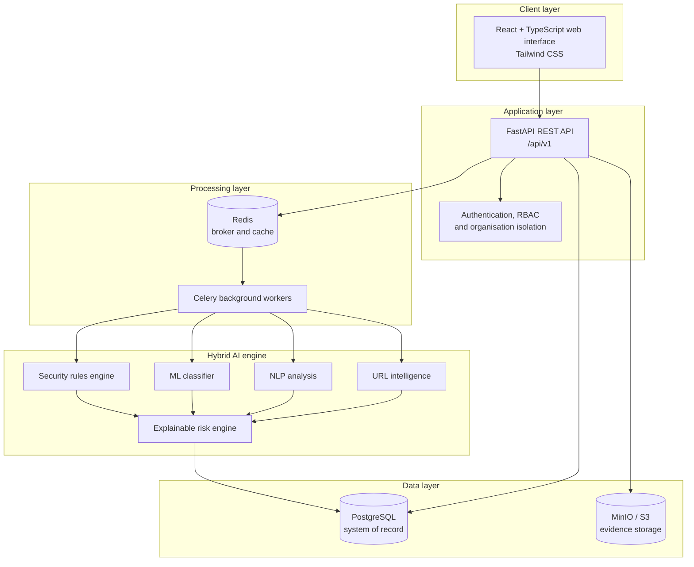
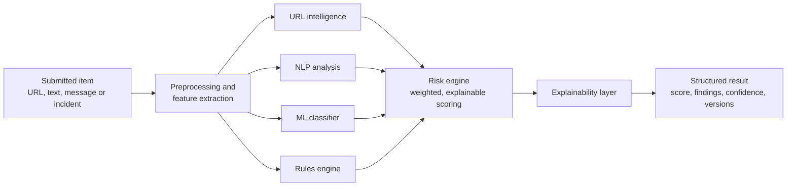
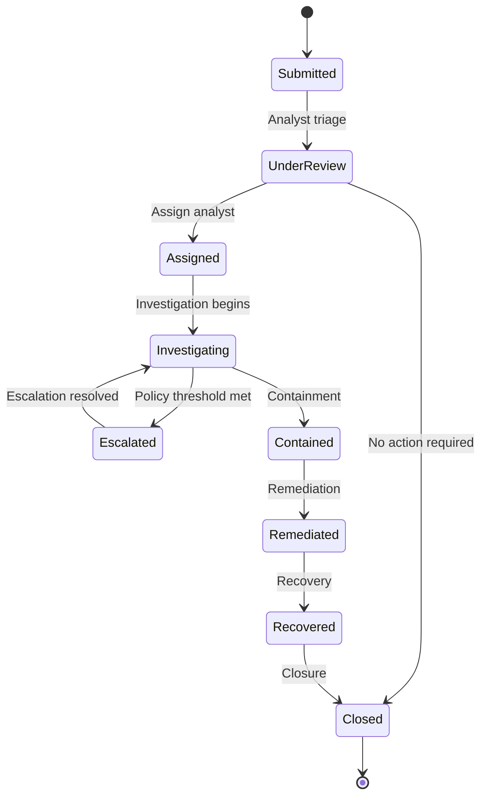
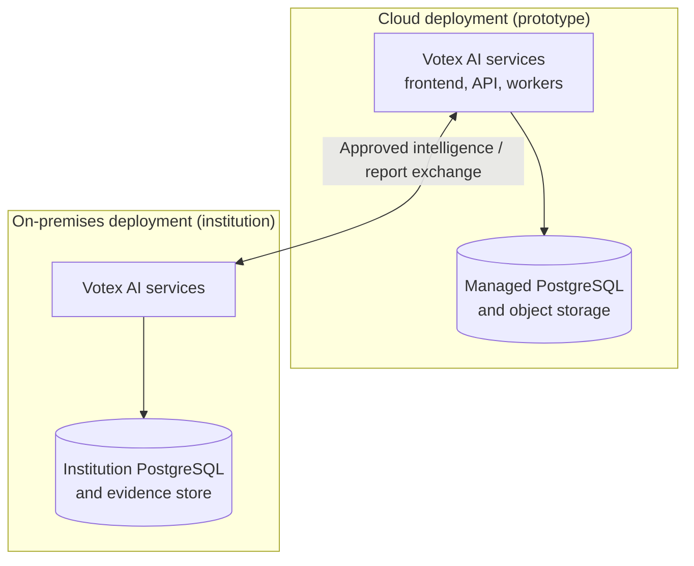

# Votex AI — Frozen Technical Architecture & Implementation Specification

> Track 4: Electoral Cybersecurity & Resilience

| Field | Detail |
| --- | --- |
| **Project** | Votex AI |
| **Tagline** | Securing Elections Through Intelligent Cybersecurity |
| **Programme** | #AI4Elections Hackathon 2026–2027 — Rise Networks, with INEC and partners |
| **Track** | Track 4 — Electoral Cybersecurity and Resilience |
| **System vision** | A national-scale, AI-assisted electoral cybersecurity intelligence and incident coordination platform |
| **Document status** | Target architecture frozen; MVP scope defined in Section 19 |
| **Prototype scope** | Controlled demonstration environment using synthetic data |
| **Application deadline** | 12 November 2026, 11:59pm WAT |
| **Prototype submission** | 13 December 2026 |
| **Team size** | 2–4 participants |
| **Proposed licence** | MIT for code; CC BY 4.0 for documentation and synthetic data |

Votex AI will be designed as a platform that can support national electoral cybersecurity coordination while also providing operational tools for authorised electoral institutions and security teams.

> **Positioning decision:** Votex AI complements existing national and electoral cybersecurity structures; it does not claim to replace INEC systems, ngCERT, or the National Cybersecurity Coordination Centre. Its prototype will demonstrate the architecture and core workflows in a controlled environment — not claim to be an approved production system for national deployment.
>
> **Competition reality check:** Judges evaluate a running prototype and its evidence, not the breadth of this specification. This document is the target architecture. **Section 19 defines the smaller MVP that must actually ship by 13 December 2026.** When the two conflict, the MVP and the competition rules take precedence.

## Contents

1. [Frozen architecture decisions](#1-frozen-architecture-decisions)
2. [System purpose and boundaries](#2-system-purpose-and-boundaries)
3. [Functional modules](#3-functional-modules)
4. [User roles and national operating model](#4-user-roles-and-national-operating-model)
5. [High-level technical architecture](#5-high-level-technical-architecture)
6. [Hybrid AI architecture](#6-hybrid-ai-architecture)
7. [Database architecture](#7-database-architecture)
8. [Security architecture](#8-security-architecture)
9. [Hybrid deployment architecture](#9-hybrid-deployment-architecture)
10. [API specification](#10-api-specification)
11. [Frontend specification](#11-frontend-specification)
12. [Phased implementation plan](#12-phased-implementation-plan)
13. [Testing and quality assurance](#13-testing-and-quality-assurance)
14. [Hackathon prototype versus future national deployment](#14-hackathon-prototype-versus-future-national-deployment)
15. [Recommended project structure](#15-recommended-project-structure)
16. [Final technology and engineering decisions](#16-final-technology-and-engineering-decisions)
17. [Standards and reference material](#17-standards-and-reference-material)
18. [Hackathon alignment and compliance](#18-hackathon-alignment-and-compliance)
19. [Realistic MVP scope](#19-realistic-mvp-scope)
20. [Improvement priorities and hardening backlog](#20-improvement-priorities-and-hardening-backlog)

## 1. Frozen architecture decisions

| Decision | Final selection |
| --- | --- |
| Scope | National electoral cybersecurity intelligence and agency operations |
| Deployment model | Hybrid: cloud-ready prototype with on-premises deployment capability |
| AI approach | Hybrid AI: machine learning + NLP + rules + explainable risk scoring |
| Core backend | Python + FastAPI |
| Frontend | React + TypeScript |
| Primary database | PostgreSQL |
| Background processing | Redis + Celery |
| AI/ML | Scikit-learn; NLP models and anomaly detection where justified |
| Evidence storage | S3-compatible object storage, with local/on-premises option |
| Authentication | JWT, refresh tokens, RBAC and MFA-ready design |
| API style | REST API, documented with OpenAPI |
| Prototype orchestration | Docker Compose; Kubernetes-ready architecture for future scale |
| Accessibility | WCAG 2.2 AA, keyboard navigation and screen-reader support |
| Languages | English + Hausa, Yoruba and Igbo; Nigerian Pidgin as a stretch goal |
| Audit integrity | SHA-256 hash-chained, append-only audit log |
| Aggregate privacy | k-anonymity suppression (k ≥ 5) for national-level statistics |

These are the fixed architectural choices. We should not keep changing the stack during implementation unless a genuine technical limitation appears.

## 2. System purpose and boundaries

### 2.1 What Votex AI will do

Votex AI will provide a shared cybersecurity intelligence and incident-management environment for authorised electoral stakeholders.

Its primary capabilities will be:

1. Receive and manage cybersecurity incident reports.
2. Analyse suspicious URLs, messages, email content and submitted evidence.
3. Detect phishing, impersonation, malicious indicators and suspicious activity patterns.
4. Assign explainable risk scores and prioritise incidents.
5. Correlate related incidents and indicators across authorised participating organisations.
6. Coordinate incident assignment, escalation, investigation and resolution.
7. Assess organisational cyber resilience and track remediation.
8. Generate national-level situational-awareness reports from permitted, aggregated data.
9. Provide controlled cybersecurity exercises and simulations.

### 2.2 What Votex AI will not do

- Connect to or scan INEC systems without written authorisation.
- Access election databases, voter registers or result-transmission infrastructure.
- Declare election results, determine electoral fraud or make political judgments.
- Automatically block organisations, suspend accounts or take operational action based only on an AI prediction.
- Publish confidential incident details to other organisations without authorisation.
- Treat an AI risk score as proof that an attack occurred.

> **National-context consideration:** INEC already operates an Election Monitoring and Support Centre incorporating electoral risk and operational monitoring. Votex AI should therefore focus on the specialist cybersecurity intelligence, evidence analysis, incident coordination and resilience capabilities it can add — not claim to replace existing electoral risk-management systems.
>
> **Coordination consideration:** Nigeria also has an established national cybersecurity coordination and incident-response structure involving the NCCC and ngCERT. Votex AI should support authorised coordination and information sharing with relevant structures, not position itself as a replacement national CERT.

## 3. Functional modules

### 3.1 Electoral Incident Intelligence

- Submit incident reports through a secure reporting portal.
- Capture incident type, time, affected organisation, description, evidence and source.
- Generate unique incident references.
- Track status, ownership, priority and resolution.
- Support secure evidence uploads and evidence integrity hashes.

### 3.2 AI Threat Detection and Analysis

- Analyse submitted URLs, email text, messages and incident descriptions.
- Detect suspicious URL structures, phishing language, impersonation indicators and known malicious patterns.
- Apply machine-learning classification and deterministic security rules.
- Explain why an item was flagged.
- Return confidence, risk factors and recommended analyst actions.

### 3.3 Electoral Threat Intelligence

- Extract indicators of compromise (IOCs), such as domains, URLs, IP addresses and file hashes.
- Identify repeated indicators across authorised reports.
- Link related incidents and display their relationships.
- Maintain a searchable threat-intelligence repository.
- Map relevant adversary behaviours to MITRE ATT&CK where justified. ATT&CK is a knowledge base of observed adversary tactics and techniques, not a checklist for declaring an attack.

### 3.4 Incident Response and Coordination

- Assign incidents to authorised analysts.
- Escalate incidents based on severity and organisational policy.
- Record investigation notes, actions and decisions.
- Maintain incident timelines and audit trails.
- Track containment, remediation, recovery and closure.

### 3.5 Electoral Cyber Resilience

- Conduct structured organisational security assessments.
- Track identified risks, controls and remediation actions.
- Record readiness indicators and outstanding issues.
- Generate resilience reports and trend summaries.

### 3.6 Cybersecurity Simulation and Training

- Provide safe, isolated phishing-awareness exercises.
- Run synthetic incident-response scenarios.
- Measure response time and completion of required actions.
- Generate training and readiness reports.

## 4. User roles and national operating model

The system will use role-based access control (RBAC), organisation-level separation and least privilege.

| Role | Main permissions |
| --- | --- |
| National Super Administrator | Configure the platform, organisations, policies and system-wide access |
| National Intelligence Analyst | View authorised cross-organisation intelligence and analyse correlated threats |
| Organisation Administrator | Manage users, permissions and settings within their organisation |
| Organisation Security Analyst | Investigate and manage incidents belonging to their organisation |
| Incident Reporter | Submit reports and view permitted updates |
| Auditor / Read-only Reviewer | Review authorised records, reports and audit trails |

> **Important:** A national administrator should not automatically have unrestricted access to every organisation's raw evidence. Cross-organisation access must be governed by explicit permissions, purpose limitation and information-sharing rules.

### National operating model

The logical operating model is:

- **National layer:** aggregated intelligence, incident trends, threat correlation and national situational awareness.
- **Organisation layer:** organisation-specific incident handling, evidence, analyst assignments and resilience assessments.
- **Reporting layer:** controlled incident submission, status tracking and authorised notifications.

For the prototype, these layers will be represented using multiple test organisations and synthetic incidents. No real institutional integration is required.

## 5. High-level technical architecture



### 5.1 Component responsibilities

| Component | Technology | Responsibility |
| --- | --- | --- |
| Web interface | React + TypeScript | Dashboards, reporting, analyst workflows |
| Styling | Tailwind CSS | Responsive interface and design system |
| Backend | FastAPI | API, business logic and integration |
| Authentication | JWT + password hashing | Secure authentication and sessions |
| Database | PostgreSQL | Users, organisations, incidents and intelligence |
| ORM / migrations | SQLAlchemy + Alembic | Database access and schema changes |
| Background jobs | Celery | Asynchronous analysis and report generation |
| Message broker | Redis | Job queue and short-lived cache |
| ML | Scikit-learn | Classification and anomaly detection |
| NLP | Lightweight NLP pipeline | Suspicious-language and impersonation analysis |
| Evidence storage | MinIO / S3-compatible storage | Secure uploaded files and evidence |
| Deployment | Docker Compose | Reproducible prototype deployment |
| Testing | Pytest + Playwright | Backend, API and end-to-end testing |

> **Why this architecture?** It separates the user interface, API, AI processing, workflow management and evidence storage. This makes the prototype easier to test and allows future services to be deployed independently.

## 6. Hybrid AI architecture

The AI engine is the core intelligence component. It will combine four analysis methods rather than depend on one model.



### 6.1 AI components

| Component | Purpose | Proposed implementation |
| --- | --- | --- |
| URL intelligence | Identify suspicious URL characteristics | Python feature extraction and security rules |
| NLP analysis | Identify phishing and impersonation language | TF-IDF + Logistic Regression initially |
| ML classifier | Classify submitted content | Scikit-learn Random Forest or Logistic Regression |
| Anomaly detection | Identify unusual patterns in incident activity | Isolation Forest, where sufficient data exists |
| Rules engine | Apply known security indicators and policy rules | Python-based configurable rules |
| Risk engine | Combine findings into a prioritised score | Weighted, explainable scoring |
| Correlation engine | Identify related incidents and repeated indicators | PostgreSQL queries and relationship logic |

### 6.2 Analysis pipeline

1. The user submits an item or incident.
2. The API validates the input and checks file type and size.
3. The system normalises the content and extracts useful features.
4. URL, NLP, ML and rules-based analysis run independently.
5. The risk engine combines the findings.
6. The explainability layer generates reasons for the assessment.
7. The result is stored with the model version and analysis timestamp.
8. An authorised analyst reviews the assessment and determines the incident's operational status.

### 6.3 Explainable risk scoring

Use a configurable score from 0–100.

An initial design:

$$
R = 0.30U + 0.25N + 0.25M + 0.20I
$$

Where:

- $U$ = URL and domain risk score.
- $N$ = NLP content risk score.
- $M$ = machine-learning risk score.
- $I$ = indicator and rule-based risk score.

Each input is normalised to 0–100. The weights are initial engineering choices, not scientifically validated values. They must be tuned and evaluated against labelled test data.

| Score | Initial classification | Suggested handling |
| --- | --- | --- |
| 0–24 | Low | Record; no urgent action |
| 25–49 | Moderate | Review when capacity allows |
| 50–74 | High | Prioritise analyst review |
| 75–100 | Critical | Immediate priority for human assessment |

These categories are triage recommendations, not proof of malicious activity.

Every analysis result must include:

- Overall score and category.
- Individual model and rule findings.
- Reasons that influenced the result.
- Confidence or uncertainty.
- Model and ruleset versions.
- Time of analysis.
- Human reviewer decision, where available.

> **Data-quality warning:** Do not train on unverified incident reports as if they were confirmed attacks. Labelled data should be reviewed, and evaluation should include false-positive and false-negative rates, precision, recall and F1-score.

### 6.4 Training data strategy

For the hackathon prototype:

- Use public, legally reusable cybersecurity datasets.
- Use synthetic electoral-themed messages and URLs for domain-specific demonstrations.
- Create benign and suspicious examples with clearly documented labels.
- Use synthetic incident reports to test classification and correlation.
- Keep training, validation and test sets separate.
- Record dataset provenance, licence and preprocessing steps.

> **Privacy boundary:** Do not scrape private communications or collect real voter information. The prototype should work without access to sensitive electoral data.

### 6.5 Model documentation and evaluation

Every model or ruleset used in the demo must be documented and evaluated, not merely demonstrated.

Required documentation:

- **Model card:** intended use, out-of-scope use, training data, features, metrics, limitations, ethical considerations and known failure modes.
- **Datasheet:** provenance, licence, collection method, preprocessing, labelling and known biases for every dataset used.
- **Safety and limitations statement:** what the system cannot do, residual risks and the controls required before any pilot.
- **Version record:** model name, version, training date, dataset reference and evaluation results.

Required evaluation:

- Precision, recall, F1, false-positive rate and false-negative rate on a held-out test set.
- Confusion matrix and a short error analysis of representative failures.
- Separate reporting for benign and suspicious classes; do not report accuracy alone.
- Calibration or confidence-band reporting where the model exposes probabilities.
- Language and dialect checks for Nigerian-English, Hausa, Yoruba, Igbo and Pidgin examples where feasible.
- A documented feedback loop showing how an analyst correction is recorded and used.

> **Explainability requirement:** A score without reasons is not acceptable. Every result must show the rules, features or model contributions that produced it, together with the model and ruleset versions.

## 7. Database architecture

Use PostgreSQL as the main source of truth.

### Core entities

| Table | Important fields |
| --- | --- |
| `users` | id, organisation_id, name, email, password_hash, role_id, status |
| `organisations` | id, name, organisation_type, state, status |
| `roles` | id, name, permission_set |
| `incidents` | id, organisation_id, reference, title, description, category, severity, status |
| `incident_assignments` | incident_id, assigned_user_id, assigned_at |
| `evidence` | id, incident_id, storage_key, file_hash, file_type, uploaded_by |
| `indicators` | id, indicator_type, indicator_value, confidence, source |
| `incident_indicators` | incident_id, indicator_id, relationship |
| `analysis_results` | id, incident_id, score, classification, explanation, model_version |
| `response_actions` | id, incident_id, action_type, notes, performed_by, timestamp |
| `incident_relationships` | source_incident_id, related_incident_id, relationship_type |
| `resilience_assessments` | id, organisation_id, assessment_date, score, status |
| `resilience_findings` | assessment_id, category, finding, remediation_status |
| `notifications` | id, recipient_id, incident_id, message, read_at |
| `audit_logs` | id, actor_id, organisation_id, action, resource_type, resource_id, timestamp, prev_hash, entry_hash |
| `model_versions` | id, model_name, version, dataset_reference, metrics, active |

### Database rules

- Every organisation-owned record must include an `organisation_id`.
- Enforce organisation boundaries in backend queries and, where practical, PostgreSQL Row-Level Security.
- Use foreign keys and appropriate indexes.
- Store passwords as secure hashes, never plaintext.
- Store evidence files in object storage, not directly as large database blobs.
- Store the evidence hash and storage reference in PostgreSQL.
- Keep audit events append-only for normal application roles.
- Use UTC timestamps internally and display local time appropriately.
- Exclude evidence content, free-text notes and personal data from national aggregate queries.
- Apply k-anonymity suppression (k ≥ 5) before returning any national-level cell or breakdown.

### Audit integrity

The prototype must make tampering evident, not merely discourage it.

- Each audit entry stores `prev_hash` (the previous entry's `entry_hash`) and its own `entry_hash`.
- `entry_hash = SHA-256(prev_hash || canonical_json(entry_without_hash))`.
- A verification endpoint or CLI command recalculates the chain and reports the first broken entry.
- Audit writes happen in the same transaction as the action they record where practical.
- Normal application roles cannot update or delete audit rows.

> This design directly supports Track 4's interest in tamper-evident, hash-chained audit trails for electoral workflows.

### Core incident lifecycle



> **Separation of concerns:** Keep the machine-generated classification separate from the incident workflow status. For example, AI can classify a submission as suspicious while an analyst leaves the incident in **Under Review**.

## 8. Security architecture

Security must be built into every layer. This is particularly important because the platform itself will handle sensitive incident reports and security evidence.

### 8.1 Authentication and access control

- JWT access tokens with short expiry.
- Secure refresh-token rotation and revocation.
- Password hashing using Argon2id or bcrypt.
- Role-based permissions.
- Organisation-level data isolation.
- MFA-ready authentication design.
- Rate limiting and account lockout controls.
- Session and token revocation.

### 8.2 Data protection

- Comply with the **Nigeria Data Protection Act 2023 (NDPA)** and applicable institutional data-governance rules.
- HTTPS/TLS for all network traffic.
- Encryption at rest for databases, backups and evidence storage.
- Managed encryption keys in production; no hard-coded secrets.
- Sensitive fields minimised and protected.
- Document the lawful basis, purpose and retention period for each category of personal data.
- Retention and deletion policies, including deletion of synthetic demo data after evaluation.
- Redaction of secrets and personal information in logs.
- Controlled export of incident reports.
- A documented process for data-subject requests where personal data is processed.

### 8.3 Evidence protection

For every uploaded evidence file:

1. Validate extension, MIME type and file size.
2. Generate a cryptographic SHA-256 hash.
3. Store it in isolated evidence storage.
4. Record the hash, uploader, timestamp and incident reference.
5. Restrict access by role and organisation.
6. Record every access, download and change of evidence metadata.

> A hash supports integrity verification; it does not by itself prove who created the file or that the original evidence is authentic.

### 8.4 Safe URL analysis

This deserves special attention. A submitted URL must never cause the backend to make an unrestricted request to an arbitrary destination.

- Do not automatically visit submitted URLs from the main application server.
- Block private, loopback, link-local and reserved IP ranges.
- Defend against DNS rebinding and redirects to internal destinations.
- Do not allow arbitrary protocols.
- If live enrichment is later authorised, use a restricted analysis worker with outbound network controls, timeouts and isolated execution.
- For the initial prototype, rely on static URL analysis and safe synthetic examples.

### 8.5 Application security

Build against the OWASP API Security Top 10, particularly object-level authorisation, authentication, resource consumption, security misconfiguration and server-side request forgery.

Also include:

- Input validation and output encoding.
- CSRF protection where cookie-based authentication is used.
- Secure CORS configuration.
- SQL injection prevention through parameterised ORM queries.
- Secure HTTP headers.
- Dependency and container image scanning in CI.
- Automated tests for cross-organisation access attempts.
- Backup and restoration tests.
- A formal **STRIDE or LINDDUN threat model** covering the web app, API, workers, evidence storage, authentication and national aggregation.
- A finding-to-control matrix showing which threat each mitigation addresses.
- A residual-risk register with likelihood, impact, owner and acceptance decision.
- A responsible-disclosure policy for vulnerabilities found in the project or reported by others.

### 8.6 Governance and incident response

Use NIST SP 800-61 Rev. 3 as a reference for integrating incident response into the wider cybersecurity risk-management process. It was finalised in April 2025 and aligns incident response with the NIST Cybersecurity Framework 2.0.

For the national prototype, document:

- Who is authorised to submit, view and share information.
- Who can escalate an incident.
- What constitutes a national-level escalation.
- How sensitive information is protected.
- How human review and correction work.
- How model errors and security incidents are reported.

### 8.7 Privacy-preserving analytics and reporting

The national view is the highest-risk feature because it combines data across organisations.

- National dashboards expose aggregated counts and trends only — never raw evidence, free-text descriptions or analyst notes.
- Suppress any cell, table or chart segment with fewer than **5** contributing incidents or organisations (k-anonymity, k ≥ 5).
- Do not publish organisation-identifying breakdowns without explicit permission.
- Apply the same suppression to exports, API responses and screenshots used in demos.
- Record aggregate queries in the audit log.
- Add privacy tests that attempt small-cell leakage through filters, date ranges and cross-filtering.
- Differential privacy is a post-hackathon improvement, not an MVP requirement.

> **Track 4 alignment:** privacy-preserving reporting is explicitly named in the Track 4 brief. The k-anonymity rule gives the prototype a measurable privacy story rather than a claim.

## 9. Hybrid deployment architecture

The hybrid model means Votex AI can operate in a cloud-hosted environment for the prototype while retaining a deployment design suitable for an organisation's private infrastructure.



### Deployment modes

| Mode | Description |
| --- | --- |
| Cloud | Centralised hosted deployment |
| On-premises | Organisation-hosted application, database and evidence storage |
| Hybrid | Approved exchange of selected intelligence or reports between environments |

**Prototype implementation:** Start with one Docker Compose deployment. Simulate separate organisations using tenant isolation. Do not attempt a real multi-cloud or distributed national deployment during the hackathon.

**Future deployment:** Provide environment-specific configuration, containerised services, secrets management, backup procedures and infrastructure documentation. Kubernetes can be introduced when there is a genuine operational requirement.

## 10. API specification

Use versioned REST endpoints under `/api/v1`.

| Area | Endpoint | Method | Purpose |
| --- | --- | --- | --- |
| Authentication | `/auth/login` | POST | Authenticate |
| Authentication | `/auth/refresh` | POST | Refresh access token |
| Authentication | `/auth/logout` | POST | Revoke session |
| Users | `/users/me` | GET | Current user profile |
| Organisations | `/organisations` | GET | List permitted organisations |
| Incidents | `/incidents` | POST | Submit incident |
| Incidents | `/incidents` | GET | List permitted incidents |
| Incidents | `/incidents/{id}` | GET | Incident details |
| Incidents | `/incidents/{id}` | PATCH | Update permitted fields |
| Incidents | `/incidents/{id}/assign` | POST | Assign analyst |
| Incidents | `/incidents/{id}/actions` | POST | Record response action |
| Evidence | `/incidents/{id}/evidence` | POST | Upload evidence |
| Analysis | `/analysis/url` | POST | Analyse a URL |
| Analysis | `/analysis/text` | POST | Analyse text |
| Analysis | `/incidents/{id}/analyse` | POST | Analyse incident |
| Intelligence | `/indicators` | GET | Search permitted indicators |
| Intelligence | `/incidents/{id}/related` | GET | Find related incidents |
| Resilience | `/resilience/assessments` | POST | Create assessment |
| Resilience | `/resilience/assessments` | GET | View assessments |
| Reports | `/reports/summary` | GET | Generate summary |
| Dashboard | `/dashboard/overview` | GET | Dashboard statistics |
| Audit | `/audit-logs` | GET | View permitted audit records |

All endpoints must enforce authentication, authorisation, input validation and organisation boundaries. Use pagination and filtering for collection endpoints.

## 11. Frontend specification

The interface should look like a professional cybersecurity operations platform — not a generic student dashboard.

### Main navigation

- Overview
- Incident Intelligence
- AI Threat Analysis
- Threat Intelligence
- Incident Response
- Resilience Assessment
- Cyber Exercises
- Reports and Analytics
- Audit Logs
- Settings

### Required screens

| Screen | Important elements |
| --- | --- |
| Login | Secure login, organisation identity, MFA-ready flow |
| National dashboard | Aggregated incidents, severity distribution, trends and state-level summaries where data permits |
| Organisation dashboard | Organisation's incidents, pending work and response metrics |
| Incident submission | Report form, evidence upload and reference generation |
| Incident details | Timeline, AI findings, evidence, assignment and actions |
| AI analysis | Risk score, classification, explanations and model findings |
| Threat intelligence | Searchable indicators and incident relationships |
| Response centre | Assigned cases, escalation, response status and investigation notes |
| Resilience | Assessment progress, findings and remediation |
| Simulation | Synthetic exercise scenarios and performance |
| Reports | Filterable analytics and exportable summaries |
| Administration | Users, roles, organisations and policies |
| Audit | Searchable security and activity events |

### Inclusion, accessibility and multilingual requirements

Inclusion and multilingual capability carry **15% of the judging score**, so these are prototype requirements, not polish.

- **Languages:** English plus Hausa, Yoruba and Igbo for the interface and incident intake. Nigerian Pidgin is a stretch goal.
- **Localisation architecture:** all user-facing strings live in translation files; no hard-coded interface text.
- **Accessibility:** target WCAG 2.2 AA, including keyboard-only operation, visible focus states, semantic headings, form labels, error identification and screen-reader announcements.
- **Severity cues:** never rely on colour alone; pair colour with text, icons and labels.
- **Low-bandwidth mode:** lightweight pages, compressed assets, no unnecessary video or heavy animation, and a usable experience on a slow mobile connection.
- **Plain language:** short sentences, clear security terms and contextual help for non-specialist reporters.
- **Inclusive reporting:** allow reports to be submitted on behalf of a community or colleague without exposing personal details.
- **Testing:** automated accessibility checks plus manual keyboard and screen-reader checks; test translated layouts for overflow.

### Design direction

- Dark-first cybersecurity interface with a professional light mode.
- Navy/charcoal backgrounds, restrained cyan/blue accents and clear warning colours.
- Strong typography and readable data visualisations.
- Responsive layout for desktop, tablet and mobile.
- Consistent incident severity indicators.
- Accessible contrast and keyboard navigation.
- Avoid decorative animations that distract from incident information.
- Include a visible language switcher and accessible help text on every main screen.

## 12. Phased implementation plan

The development must proceed in phases. Each phase has a deliverable and a manual test. We should not start the next phase until the current phase passes its tests.

> **Implementation sequence frozen.**
>
> **Sprint note:** The ten phases below describe the full target product, not the hackathon sprint. The 13 December submission must follow the reduced **MVP scope in Section 19**. Treat the later phases as post-hackathon work unless the MVP is complete and tested.

### Phase 1 — Project foundation and environment

Set up the repository, React frontend, FastAPI backend, PostgreSQL, Redis and Docker Compose.

**Deliverables:**

- Working development environment.
- Frontend and backend health endpoints.
- Database connection.
- Environment configuration and `.env.example`.
- Initial project documentation.

**Acceptance test:** Start the application using Docker Compose and successfully access the frontend, API health endpoint and database.

### Phase 2 — Authentication and organisational access

Implement users, organisations, roles, login, token management and permission enforcement.

**Deliverables:**

- Login and logout.
- User and organisation management.
- RBAC middleware/dependencies.
- Organisation data isolation.
- Initial audit logging.

**Acceptance test:** A user from Organisation A cannot retrieve Organisation B's incidents by changing an ID or API request.

### Phase 3 — Incident management

Build the reporting and incident lifecycle.

**Deliverables:**

- Incident submission form.
- Incident reference generation.
- Incident listing and filtering.
- Incident detail page.
- Assignment and status management.
- Incident timeline.

**Acceptance test:** A reporter submits an incident; an authorised analyst sees it, assigns it and updates its status.

### Phase 4 — Evidence management

Implement secure file uploads and evidence integrity.

**Deliverables:**

- File validation.
- Encrypted evidence storage.
- SHA-256 hash generation.
- Evidence metadata records.
- Evidence access logging.

**Acceptance test:** Upload an evidence file, retrieve it with authorised access and verify that its calculated hash matches the recorded hash.

### Phase 5 — AI threat analysis

Build the hybrid analysis engine.

**Deliverables:**

- URL feature extraction.
- Text preprocessing.
- NLP classifier.
- ML classifier.
- Security rules engine.
- Explainable risk scoring.
- Analysis history and model versioning.

**Acceptance test:** Submit known benign and suspicious test examples; the engine returns a structured result with risk factors and explanations. Record precision, recall, F1 and false-positive results on a held-out dataset.

### Phase 6 — Threat intelligence and correlation

Connect indicators to incidents and identify recurring threats.

**Deliverables:**

- IOC extraction.
- Indicator database.
- Related-incident detection.
- Correlation view.
- MITRE ATT&CK mapping where applicable.

**Acceptance test:** Two synthetic incidents containing the same indicator are linked, with the relationship visible to authorised analysts.

### Phase 7 — Response coordination and resilience

Build the operational response workflow and organisational assessment.

**Deliverables:**

- Analyst assignment.
- Escalation rules.
- Investigation and response notes.
- Resolution tracking.
- Resilience assessments.
- Remediation status tracking.

**Acceptance test:** An analyst takes a high-priority synthetic incident through assignment, investigation, response and closure, with an auditable record of each step.

### Phase 8 — National dashboard and analytics

Create the national intelligence view and reporting functions.

**Deliverables:**

- Aggregated incident metrics.
- Severity and category trends.
- Organisation-level summaries.
- State-level summaries using synthetic data.
- Incident trend reports.
- Permission-aware reporting and exports.

**Acceptance test:** National users see permitted aggregated statistics while organisation users see only their authorised data.

### Phase 9 — Cyber exercises and simulations

Implement controlled synthetic incident-response exercises.

**Deliverables:**

- Scenario library.
- Exercise assignment.
- Analyst task tracking.
- Exercise performance reports.

**Acceptance test:** A user completes a simulated incident exercise and the platform records the actions and outcome without interacting with real external systems.

### Phase 10 — Hardening, deployment and demonstration

Prepare the prototype for judging and technical evaluation.

**Deliverables:**

- Automated tests.
- Security review.
- Docker deployment.
- Seeded demo data.
- Architecture and API documentation.
- Demonstration script.
- Known limitations and future roadmap.

**Acceptance test:** A fresh deployment can be started from the documentation, seeded with synthetic data and demonstrated from reporting through AI analysis and incident resolution.

## 13. Testing and quality assurance

Testing is not a final activity. Every phase must have tests.

| Test category | What we must verify |
| --- | --- |
| Unit testing | Risk scoring, validation, classification and business logic |
| API testing | Endpoint behaviour, permissions and validation |
| Integration testing | Database, Redis, workers and evidence storage |
| AI evaluation | Precision, recall, F1, false positives and false negatives on a held-out set |
| Security testing | Authentication, authorisation, injection and tenant isolation |
| Privacy testing | k-anonymity suppression, small-cell leakage and re-identification attempts |
| Audit testing | Hash-chain verification and tamper detection |
| File testing | Upload restrictions, integrity and access control |
| Accessibility testing | WCAG 2.2 AA checks, keyboard-only use and screen-reader labels |
| Localisation testing | Hausa, Yoruba and Igbo strings, layout overflow and fallback behaviour |
| Performance testing | API latency and background-job handling |
| Recovery testing | Backup and restoration |
| End-to-end testing | Full incident submission-to-closure workflow |
| Usability testing | Clear reporting and analyst workflows |

### Minimum demonstration test cases

1. A user submits a suspicious electoral-themed email.
2. Votex AI analyses the message and explains suspicious indicators.
3. The platform creates an incident record.
4. An analyst reviews and assigns the incident.
5. The analyst records a response action.
6. A second synthetic report contains a related indicator.
7. The threat intelligence module identifies the relationship.
8. The national dashboard updates its aggregated incident metrics.
9. An organisation user cannot access another organisation's private evidence.
10. The audit log records the relevant actions and the hash chain verifies successfully.
11. Tampering with an audit entry is detected by the verification command.
12. A national aggregate cell with fewer than five contributors is suppressed.
13. A reporter completes a submission using the keyboard only and switches the interface to Hausa or Yoruba.

All thirteen tests are required for the MVP. Tests 1–10 prove the core workflow; tests 11–13 prove the privacy, integrity and inclusion claims.

## 14. Hackathon prototype versus future national deployment

We must separate what we will genuinely build from what the architecture can support later.

| Capability | Hackathon prototype | Future national deployment |
| --- | --- | --- |
| Multiple organisations | Simulated tenants | Verified participating institutions |
| National dashboard | Synthetic aggregated data | Authorised national intelligence feeds |
| AI analysis | Locally trained/tested models | Validated, monitored production models |
| Threat intelligence | Synthetic and public indicators | Approved intelligence-sharing arrangements |
| Incident coordination | Demonstration workflow | Formal institutional response procedures |
| Deployment | Docker Compose | Hardened hybrid infrastructure |
| Integrations | Mock API integrations | Approved and secured institutional APIs |
| Availability | Local/demo environment | Resilient production infrastructure |
| Governance | Documented prototype policies | Formal legal, privacy and operational approval |

A national-scale design does not mean we need to build a national-scale infrastructure for the hackathon. It means the software architecture, security controls, tenant model and operational workflows should be designed with that future in mind.

## 15. Recommended project structure

This is the intended repository structure. We will create it progressively rather than generate every file at once.

```text
votex-ai/
│
├── frontend/
│   ├── public/
│   └── src/
│       ├── assets/
│       ├── components/
│       ├── layouts/
│       ├── pages/
│       ├── features/
│       │   ├── auth/
│       │   ├── incidents/
│       │   ├── intelligence/
│       │   ├── analysis/
│       │   ├── resilience/
│       │   ├── reports/
│       │   └── administration/
│       ├── services/
│       ├── hooks/
│       ├── types/
│       └── App.tsx
│
├── backend/
│   ├── app/
│   │   ├── api/
│   │   │   └── v1/
│   │   ├── core/
│   │   ├── models/
│   │   ├── schemas/
│   │   ├── services/
│   │   ├── repositories/
│   │   ├── middleware/
│   │   ├── security/
│   │   ├── intelligence/
│   │   ├── incident_response/
│   │   ├── resilience/
│   │   ├── workers/
│   │   └── main.py
│   ├── migrations/
│   └── tests/
│
├── ai-engine/
│   ├── datasets/
│   ├── preprocessing/
│   ├── features/
│   ├── models/
│   ├── evaluation/
│   ├── rules/
│   ├── explainability/
│   └── training/
│
├── infrastructure/
│   ├── docker/
│   ├── deployment/
│   └── monitoring/
│
├── docs/
│   ├── architecture/
│   ├── api/
│   ├── security/
│   ├── testing/
│   ├── model/
│   ├── data/
│   ├── safety/
│   └── demo/
│
├── docker-compose.yml
├── .env.example
├── .gitignore
└── README.md
```

## 16. Final technology and engineering decisions

| Area | Frozen decision |
| --- | --- |
| Frontend | React + TypeScript + Vite |
| UI | Tailwind CSS |
| Backend | Python + FastAPI |
| Database | PostgreSQL |
| ORM | SQLAlchemy |
| Migrations | Alembic |
| Authentication | JWT + Argon2id/bcrypt |
| Task queue | Celery |
| Broker/cache | Redis |
| ML | Scikit-learn |
| NLP | TF-IDF + classical classifier initially |
| Anomaly detection | Isolation Forest, if justified by data |
| Evidence storage | MinIO / S3-compatible |
| Evidence integrity | SHA-256 |
| Audit integrity | SHA-256 hash chain |
| Aggregate privacy | k-anonymity suppression (k ≥ 5) |
| Accessibility | WCAG 2.2 AA |
| Languages | English + Hausa, Yoruba and Igbo; Pidgin stretch |
| Documentation | README, model card, datasheet, safety and limitations |
| API documentation | OpenAPI / Swagger |
| Backend tests | Pytest |
| Frontend tests | Playwright |
| Deployment | Docker Compose |
| Version control | Git + GitHub |
| Licence | MIT (code) and CC BY 4.0 (documentation and synthetic data) |

> **Delivery principle:** We will not introduce Kafka, Kubernetes, microservices, blockchain or deep-learning infrastructure simply to make the project sound more advanced. They should only be added if a demonstrated requirement justifies them.

## 17. Standards and reference material

The technical design should be informed by:

- [NIST SP 800-61 Rev. 3](https://csrc.nist.gov/pubs/sp/800/61/r3/final) — incident response and cybersecurity risk management.
- [MITRE ATT&CK](https://attack.mitre.org/) — adversary behaviour and technique mapping.
- [OWASP API Security Top 10](https://owasp.org/API-Security/) — API security risks.
- [OWASP Threat Modeling](https://owasp.org/www-community/Threat_Modeling) — STRIDE and threat-model practice.
- [W3C Web Content Accessibility Guidelines 2.2](https://www.w3.org/TR/WCAG22/) — accessibility target.
- [Nigeria Data Protection Act 2023](https://www.ndpc.gov.ng/) — data-protection obligations.
- [INEC Election Monitoring and Support Centre](https://www.inecnigeria.org/) — existing electoral monitoring context.
- [Nigeria National Cybersecurity Coordination Centre](https://www.nccc.gov.ng/) — national coordination context.
- [Nigeria Computer Emergency Response Team (ngCERT)](https://cert.gov.ng/) — national incident-response context.

Programme-specific material:

- [#AI4Elections Track 4 Technical Brief](https://github.com/Rise-Networks-AI-Labs/-AI4Elections-Hackathon/blob/main/docs/01_technical_briefs/track4_electoral_cybersecurity_resilience.md) — Track 4 scope, example problems and success criteria.
- [#AI4Elections General Challenge Rules](https://github.com/Rise-Networks-AI-Labs/-AI4Elections-Hackathon/blob/main/docs/01_technical_briefs/00_general_challenge_rules.md) — non-negotiables and minimum submission package.
- [#AI4Elections Participant Onboarding Guide](https://github.com/Rise-Networks-AI-Labs/-AI4Elections-Hackathon/blob/main/docs/03_onboarding/onboarding_guide.md) — timeline, eligibility and submission checklist.

> The Rise Networks concept document is marked confidential. Do not commit it, or any partner material marked confidential, to the public hackathon repository.

## 18. Hackathon alignment and compliance

Votex AI is submitted to the **#AI4Elections Hackathon 2026–2027**, **Track 4: Electoral Cybersecurity and Resilience**. The programme is national, multidisciplinary and nonpartisan, and it evaluates a working, responsible prototype. This section maps the design to the published track brief, judging rubric and submission rules.

### 18.1 Track 4 mapping

| Track 4 expectation | Votex AI response | Priority | Evidence to demonstrate |
| --- | --- | --- | --- |
| Defensive monitoring and incident reporting | Secure incident intake, triage, assignment, response actions and closure | MVP | End-to-end synthetic incident workflow |
| Phishing and impersonation awareness | Static URL analysis, NLP classification, rules and explainable risk score | MVP | Benign vs suspicious example analysed live |
| Privacy-preserving reporting | Organisation isolation, aggregate-only national view and k-anonymity suppression | MVP | Cross-tenant denial and suppressed small cell |
| Tamper-evident audit and resilience | SHA-256 evidence hashes and hash-chained audit log | MVP | Chain verification and tamper-detection test |
| Threat model and secure design | STRIDE/LINDDUN model, OWASP controls and a finding-to-control matrix | MVP documentation | `docs/security/threat-model.md` |
| Authorised simulations | One synthetic phishing-triage exercise, with no real people or systems | Should-have | Scenario run and task record |
| Resilience and failover | Lightweight resilience assessment and documented offline-tolerant design | Should-have | One completed assessment |
| Reproducible offline demo | Docker Compose, seeded synthetic data and a one-command start | MVP | Fresh clone runs without external services |

Track 4's example problem statements map as follows:

- **4B Privacy-preserving reporting:** organisation isolation plus k-anonymity for national aggregates.
- **4C Impersonation/phishing awareness:** URL and text analysis with human-readable explanations.
- **4D Resilience blueprint:** hash-chained audit trail and integrity verification.
- **4E Threat model and secure design:** STRIDE/LINDDUN model with implemented key controls.
- **4A Offline log-anomaly monitor:** partially addressed by correlation of synthetic incident indicators; full anomaly detection is a stretch goal.

### 18.2 Judging rubric alignment

| Criterion | Weight | How Votex AI addresses it | Action before submission |
| --- | --- | --- | --- |
| Technical functionality and innovation | 25% | Working end-to-end workflow, explainable hybrid analysis and reproducible deployment | Freeze features, run the demo twice, publish test evidence |
| Electoral relevance and practical usefulness | 20% | Election-specific phishing, impersonation, evidence and coordination scenarios | Write a one-page problem statement with defined users |
| Cybersecurity, privacy and responsible AI | 20% | RBAC, tenant isolation, hashing, hash-chained audit, threat model, NDPA and human review | Complete model card, safety statement and threat model |
| Inclusion, accessibility and multilingual capability | 15% | Target: four languages, WCAG 2.2 AA, keyboard support and low-bandwidth mode. MVP: English + Hausa | Run keyboard, screen-reader and localisation checks |
| Scalability, sustainability and feasibility | 15% | Modular services, Docker Compose, open licence and deployment documentation | Prove a fresh clone starts from the README |
| Demonstration and documentation | 5% | Thirteen demonstration tests, three-minute video and complete documentation set | Record, rehearse and publish the demo |

> **Interpretation:** the highest-leverage improvements are not more features. They are a stable demo, a credible security/privacy story, visible inclusion and complete documentation.

### 18.3 Minimum submission package

| Artifact | Requirement | Status |
| --- | --- | --- |
| Working prototype | Runs from the repository by following the README | To build |
| Public repository | Forked from the hackathon template, with an open licence | To create |
| Problem statement | Which brief, which users and which pain point (maximum one page) | To write |
| Methodology | Approach, data used and evaluation method | To write |
| Evidence | Metrics with test-set description, screenshots or recording, and failure cases | To produce |
| Model / system card | Completed from the programme template | To write |
| Safety and limitations | Completed from the programme template | To write |
| Data sheet | Completed for every dataset created or used | To write |
| Demo video | Three minutes maximum | To record |

### 18.4 Non-negotiable competition rules

- **Nonpartisan:** no campaign technology, voter persuasion, microtargeting or manipulation of participation.
- **No live systems:** no scanning, probing, exploiting or load-testing any live electoral or institutional system.
- **Data:** synthetic, public or explicitly authorised only; no scraping of personal data.
- **Human oversight:** tools flag, assist or inform; they do not declare results or automatically sanction people.
- **Working prototype:** idea-only decks, mockups and slide-only entries are ineligible.
- **Document limits:** every submission states what it cannot do and what is needed before further testing.
- **Winning is not approval** for operational deployment.
- **Confidentiality:** do not publish confidential programme or partner material.

### 18.5 Responsible AI and data-protection commitments

- Comply with the **Nigeria Data Protection Act 2023** and any applicable institutional data-governance requirements.
- Use synthetic, public, anonymised or expressly authorised data only; never use voter registers, biometrics or personal voter records.
- Keep a human decision-maker responsible for every consequential action.
- Publish intended use, limitations, failure modes and evaluation results for each model or ruleset.
- Test for unfair or discriminatory outcomes across languages and user groups.
- Disclose AI-tool assistance in project documentation, as required by the participant code of conduct.
- Provide a responsible-disclosure route for security issues and never test third-party systems without written authorisation.
- Do not train on unverified incident reports as though they were confirmed attacks.
- Delete synthetic demo data after evaluation where it is no longer needed.

### 18.6 INEC direction and non-endorsement

The design is consistent with the responsible-AI direction described by INEC's ICT leadership at the programme launch: human oversight, security, public trust and controlled experimentation. It also reflects INEC's stated work on an AI Governance Framework and an AI Division within its ICT Department.

Participation, consultation or feedback from INEC or any partner does **not** imply endorsement, certification, procurement or approval for deployment. The prototype must never imply an official INEC connection, and any future pilot requires separate written authorisation.

### 18.7 Track 4 success criteria

The Track 4 brief names five success criteria. Each needs a visible artifact, not just a claim.

| Success criterion | Artifact or demonstration |
| --- | --- |
| Quality of threat model | STRIDE/LINDDUN threat model with assets, trust boundaries, threats and controls |
| Demonstrated mitigations | Implemented RBAC, isolation, hashing, audit chain and upload validation, with tests |
| Privacy metrics | k-anonymity threshold, suppression counts and re-identification test results |
| Reproducible offline demo | Docker Compose, synthetic seed, README and a recorded fresh-clone run |
| Clarity on residual risk | Safety and limitations statement with a residual-risk register |

## 19. Realistic MVP scope

The prototype sprint runs from **28 November to 13 December 2026** — roughly 13 working days for a team of two to four people. The full architecture in Sections 1–17 is deliberately larger than what can be built, tested and documented in that window.

The MVP is **one polished, end-to-end workflow** that proves the Track 4 claim: a synthetic electoral phishing incident is reported, analysed, explained, correlated, assigned, resolved and audited, with privacy and inclusion demonstrated along the way.

### 19.1 Scope principles

- One workflow demonstrated twice is worth more than ten half-built modules.
- Every must-have feature has a demo moment and a test.
- Prefer a simple implementation that works offline over an ambitious one that depends on external services.
- Synthetic data only; no real institutional integration.
- Security, privacy and documentation are not stretch goals.
- Freeze features by Day 11 and spend the remaining time on evidence and rehearsal.

### 19.2 Must-have MVP

| # | Capability | Minimum implementation | Demo evidence |
| --- | --- | --- | --- |
| 1 | Authentication and tenancy | Email/password login, JWT, RBAC and two seeded organisations with strict tenant isolation | Organisation A cannot read Organisation B's incident or evidence |
| 2 | Incident management | Submission form, reference generation, list/filter, detail page, assignment, status and timeline | Reporter submits; analyst assigns, records an action and closes |
| 3 | Evidence handling | Validated upload, size/type limits, SHA-256 hash, metadata and access logging | Upload, retrieve and match the recorded hash; unauthorised access denied |
| 4 | Hybrid AI analysis | Static URL features, TF-IDF text classifier, configurable rules, 0–100 risk score, reasons and model version | One benign and one suspicious example return explainable results |
| 5 | IOC extraction and correlation | Extract domains, URLs, IPs and file hashes; link incidents that share an indicator | A second report with the same indicator appears as related |
| 6 | Dashboards | Organisation metrics plus national aggregate with k ≥ 5 suppression and no raw text | Metrics update; a small cell is suppressed |
| 7 | Tamper-evident audit | Append-only hash-chained log covering authentication, incidents, evidence, analysis and exports | Chain verifies; editing a row is detected |
| 8 | Reproducible deployment | Docker Compose, health checks, seed command, `.env.example` and README | Fresh clone starts offline and is seeded with one command |
| 9 | Inclusion baseline | English plus Hausa interface for key screens, WCAG 2.2 AA, keyboard-only flow and low-bandwidth layout | Language switch and keyboard-only submission succeed |
| 10 | Submission documentation | Problem statement, methodology, model card, datasheet, safety and limitations, three-minute video | Complete package can be submitted without further editing |

### 19.3 Should-have features

Build these only after every must-have passes its test:

- Yoruba, Igbo and Nigerian Pidgin translations.
- Lightweight resilience assessment with findings and remediation status.
- One synthetic cyber-exercise scenario with task tracking.
- CSV export of permitted incident data.
- Analyst feedback capture for model correction.
- Notification centre for assignments and status changes.
- A simple indicator-relationship graph.
- Offline draft queue for incident reports.
- Basic Isolation Forest anomaly detection if enough synthetic data exists.

### 19.4 Deferred to the Development Hub

- MFA, SSO and enterprise identity integration.
- Full national cross-organisation intelligence sharing.
- Differential privacy and formal privacy-budget reporting.
- Kubernetes, multi-cloud and high-availability deployment.
- SIEM, threat-intelligence feed and institutional API integrations.
- Mobile applications.
- Deep-learning models and large language models.
- The full 13-screen product and advanced administration.
- Automated email or SMS notifications.
- Real institutional workflows, data or production integrations.

### 19.5 Sprint plan

| Days | Focus | Exit criteria |
| --- | --- | --- |
| 1–2 | Repository, Docker Compose, database, health checks and auth skeleton | `docker compose up` works; health endpoints respond |
| 3–4 | Organisations, RBAC, incident submission, list, detail and assignment | Cross-tenant access test passes |
| 5 | Evidence upload, hashing, metadata and audit chain | Hash matches; chain verifies |
| 6–8 | AI pipeline, rules, risk score, explanations and analysis UI | Benign and suspicious examples work; metrics recorded |
| 9 | IOC extraction, correlation, dashboards and suppression | Related incidents link; small cell suppressed |
| 10 | Inclusion, accessibility, Hausa strings and UX polish | Keyboard-only flow and language switch pass |
| 11 | One should-have feature or buffer | Feature tested or scope cut |
| 12 | Documentation, model card, datasheet, safety statement and video | Submission package complete |
| 13 | Fresh-clone test, demo rehearsal and submission | Demo runs twice from a clean environment |

### 19.6 Definition of done

- [ ] A fresh clone starts with `docker compose up` and one seed command, without external services.
- [ ] All thirteen demonstration tests pass twice in a row.
- [ ] Cross-tenant access tests fail closed for incidents and evidence.
- [ ] The audit chain verifies, and tampering is detected.
- [ ] National aggregates suppress cells below k = 5.
- [ ] Every AI result includes reasons and a model/ruleset version.
- [ ] The keyboard-only flow and at least one Nigerian-language interface work.
- [ ] README, problem statement, methodology, model card, datasheet, safety statement and video are complete.
- [ ] No live system, real personal data or confidential material is included.
- [ ] The repository is public and licensed.
- [ ] The three-minute demo has been recorded and replayed successfully.

### 19.7 Cut-line rules

If the team falls behind:

1. Drop should-have features first, in reverse priority order.
2. Simplify a must-have's implementation, not its security or privacy claim.
3. Never cut authentication, tenant isolation, audit integrity, human review, synthetic-data discipline or documentation.
4. Do not start a new module after Day 10.
5. Freeze features on Day 11 and protect the final two days for evidence and rehearsal.

### 19.8 Three-minute demo narrative

| Time | Demonstration |
| --- | --- |
| 0:00–0:20 | The electoral problem: staff and voters face phishing, impersonation and fake portals |
| 0:20–0:50 | Submit a synthetic phishing report with evidence |
| 0:50–1:20 | Show the risk score, reasons, model version and analyst review |
| 1:20–1:50 | Assign, record a response action and close the incident |
| 1:50–2:20 | Show a second report linked by a shared indicator |
| 2:20–2:40 | Show the national dashboard with small-cell suppression |
| 2:40–2:55 | Verify the audit chain and demonstrate cross-tenant denial |
| 2:55–3:00 | State limitations, safeguards and what a future pilot would require |

## 20. Improvement priorities and hardening backlog

The design is strong on defensive workflow, explainability and responsible-AI posture. The following gaps matter most for Track 4 and the published rubric.

### 20.1 Ranked improvement priorities

| Priority | Gap | Why it matters | Action | Effort |
| --- | --- | --- | --- | --- |
| 1 | Inclusion and multilingual capability | 15% of the score and a core programme objective | Add i18n, WCAG 2.2 AA, keyboard support and low-bandwidth mode | Medium |
| 2 | Track 4 evidence | The brief scores threat model, privacy metrics, residual risk and offline reproducibility | Produce the threat model, privacy tests and residual-risk register | Medium |
| 3 | Working prototype | Idea-only and mockup entries are ineligible | Build the MVP in Section 19 and keep it runnable | High |
| 4 | Submission documentation | Required package plus 5% for demonstration and documentation | Complete model card, datasheet, safety statement and video | Medium |
| 5 | Tamper-evident audit | A direct Track 4 differentiator | Implement and test the hash chain | Small |
| 6 | AI evaluation rigour | Technical criterion is 25% | Report precision, recall, F1, false positives/negatives and failure cases | Medium |
| 7 | Privacy metrics | Track 4 explicitly asks for privacy-preserving reporting | Implement k-anonymity and re-identification tests | Small |
| 8 | Reproducible offline demo | A named Track 4 success criterion | One-command start, seed, README and fresh-clone test | Small |

### 20.2 Engineering hardening checklist

- Hash-chain audit entries and expose a verification command or endpoint.
- Enforce k-anonymity suppression in the query layer, not only in the UI.
- Write a STRIDE or LINDDUN threat model with a finding-to-control matrix.
- Maintain a residual-risk register with owners and acceptance decisions.
- Document data flows, retention periods and deletion procedures under the NDPA.
- Add automated cross-tenant authorisation tests for every collection endpoint.
- Add upload validation, safe filename handling and malware-scanning as a stretch goal.
- Add rate limiting, account lockout and secure session revocation.
- Run dependency and container-image scanning in CI.
- Store secrets in environment variables or a secret manager; never commit them.
- Add security headers, strict CORS and parameterised queries.
- Add accessibility and localisation checks to the test plan.
- Test backup and restoration at least once.
- Publish a responsible-disclosure policy.

### 20.3 What not to add

Do not introduce any of the following during the hackathon:

- Kafka, Kubernetes, microservices or blockchain.
- Deep-learning infrastructure or a large language model without a demonstrated need.
- Live scanning, exploitation, credential harvesting or social engineering of real people.
- Real INEC, party, observer or vendor integrations.
- Claims of national deployment, institutional endorsement or production readiness.
- A new feature that has no demo moment and no test.

### 20.4 Post-hackathon roadmap

If selected for the #AI4Elections Development Hub, the next stage should focus on:

1. Independent security review and threat-model validation.
2. Differential privacy for national statistics and a published privacy budget.
3. Offline-tolerant incident reporting for low-connectivity environments.
4. MFA, SSO and enterprise identity integration.
5. Validated models with monitoring, drift detection and analyst feedback loops.
6. Accessibility and usability testing with representative users, including Nigerian-language speakers.
7. A written institutional pilot agreement with defined scope, safeguards and approvals.
8. Open-source community governance and a public roadmap.

### 20.5 Immediate actions before the application deadline

- Confirm team membership, eligibility and the 2–4 member rule with the organisers.
- Submit the application before **12 November 2026, 11:59pm WAT**.
- Fork the hackathon repository and read the Track 4 brief, general rules and documentation templates.
- Finalise the one-page problem statement and the MVP boundary in Section 19.
- Set up the repository, Docker Compose environment and synthetic-data generator.
- Draft the model card, datasheet and safety statement early; do not leave them for the final day.
